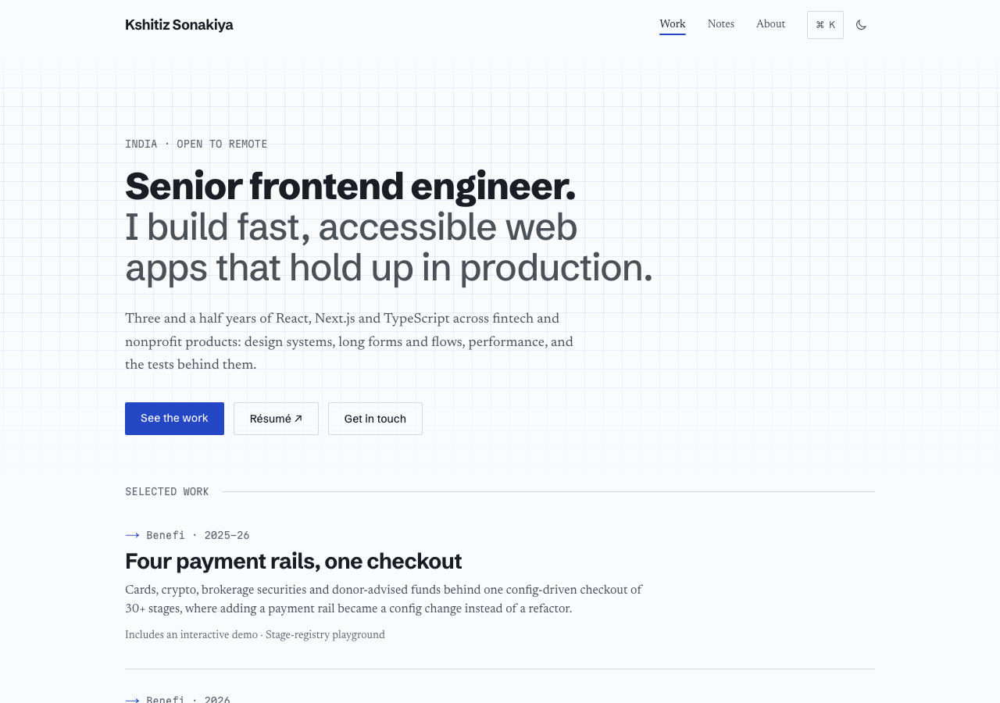

# Kshitiz Sonakiya: portfolio

[](https://github.com/kzs2501/portfolio/actions/workflows/ci.yml)
[](LICENSE)

**The source of [kshitizsonakiya.vercel.app](https://kshitizsonakiya.vercel.app):** three
case studies, technical notes, four interactive demos that rebuild the ideas behind
private production work from scratch (with made-up data), and a page for
[Dress Circle](https://github.com/kzs2501/dresscircle), an open-source ticket box office.

**Stack:** Next.js 16 (App Router, static export) · React 19 · TypeScript (strict) ·
Tailwind CSS 4 · MDX · Vitest · Playwright + axe · Lighthouse CI.



## Contents

- [Where to look](#where-to-look)
- [Quality](#quality)
- [Repository layout](#repository-layout)
- [Content review](#content-review)
- [Deploying](#deploying)
- [Licence](#licence)

## Where to look

| What                                                                                                                                                                                                                                                                                                                                                      | Start with                                                                                                                                                                                                                                                        |
| --------------------------------------------------------------------------------------------------------------------------------------------------------------------------------------------------------------------------------------------------------------------------------------------------------------------------------------------------------- | ----------------------------------------------------------------------------------------------------------------------------------------------------------------------------------------------------------------------------------------------------------------- |
| **Demos as pure logic plus a thin UI.** Each demo's behaviour is a plain, unit-tested module, and its tests assert what the case studies claim ("however many requests 401, the refresh endpoint is called once").                                                                                                                                        | [`stage-registry.ts`](src/demos/stage-registry/stage-registry.ts) · [`single-flight.ts`](src/demos/single-flight/single-flight.ts) · [`race-timeline.ts`](src/demos/race-timeline/race-timeline.ts) · [`brand-tokens.ts`](src/demos/brand-tokens/brand-tokens.ts) |
| **Demos cost nothing until you approach them.** The loader reserves each demo's height (no layout shift) and imports it when it comes within 300 px.                                                                                                                                                                                                      | [`demo.tsx`](src/components/demo.tsx)                                                                                                                                                                                                                             |
| **A hand-built ⌘K palette.** A native `<dialog>` for the focus trap and Escape, the ARIA combobox pattern inside, and its code loaded on first use.                                                                                                                                                                                                       | [`dialog.tsx`](src/components/command-palette/dialog.tsx) · [`commands.ts`](src/components/command-palette/commands.ts)                                                                                                                                           |
| **This page, measured.** The footer shows each visitor their own Core Web Vitals, read from the browser's performance timeline with no library, beside the budgets CI holds the site to. Chrome's soft-navigation timing shows a page opened without a full load; browsers that don't report something are told so. Its code loads once the page is idle. | [`web-vitals.ts`](src/lib/web-vitals.ts) · [`observe.ts`](src/components/page-measured/observe.ts) · [`readings.tsx`](src/components/page-measured/readings.tsx)                                                                                                  |
| **Motion from the platform.** React's `<ViewTransition>` for route changes and demo state, and the theme switch revealed from its button; all of it off under reduced motion.                                                                                                                                                                             | [`page-transition.tsx`](src/components/page-transition.tsx) · [`globals.css`](src/app/globals.css)                                                                                                                                                                |
| **A theme without the flash.** An inline script picks the theme before the first paint; components read it with `useSyncExternalStore`.                                                                                                                                                                                                                   | [`theme.ts`](src/lib/theme.ts) · [`layout.tsx`](src/app/layout.tsx)                                                                                                                                                                                               |
| **Colour contrast as a test.** Every text colour against its background, in both themes, by WCAG's ratio and APCA's; every colour inside sRGB; and the hex copies the share images use, kept equal to the CSS.                                                                                                                                            | [`tokens.test.ts`](src/app/tokens.test.ts) · [`contrast.ts`](src/lib/contrast.ts)                                                                                                                                                                                 |
| **Copy standards as a test.** Curly quotes, real ellipses, and no em dashes, in the content and the articles.                                                                                                                                                                                                                                             | [`typography.test.ts`](src/content/typography.test.ts)                                                                                                                                                                                                            |
| **Security headers on a static site.** Served from `vercel.json`, and a browser test that fails on any policy violation.                                                                                                                                                                                                                                  | [`vercel.json`](vercel.json) · [`security.spec.ts`](e2e/security.spec.ts)                                                                                                                                                                                         |
| **Old addresses that keep working.** The project's old page redirects to its new one, and a test checks every redirect lands on a page in the sitemap.                                                                                                                                                                                                    | [`crawler-urls.test.ts`](src/app/crawler-urls.test.ts)                                                                                                                                                                                                            |

Smaller things, from published interface guidelines (Emil Kowalski's and Vercel's):
case-study titles that morph into their headline; a reading-progress rule and a header
that firms up on scroll, both pure CSS behind `@supports`; a contents sidebar whose
active section is computed from geometry; copyable heading anchors; and a live IST clock
that tells remote visitors the time difference.

## Quality

| Check                                       | What it enforces                                                                                                                                                                                                                                                                                                                                                                                                                                                                                                                                                    |
| ------------------------------------------- | ------------------------------------------------------------------------------------------------------------------------------------------------------------------------------------------------------------------------------------------------------------------------------------------------------------------------------------------------------------------------------------------------------------------------------------------------------------------------------------------------------------------------------------------------------------------- |
| `npm run format:check`, `lint`, `typecheck` | Prettier; strict TypeScript (`noUncheckedIndexedAccess`, `exactOptionalPropertyTypes`, …); type-aware ESLint with naming conventions and import boundaries (content is data, lib doesn't depend on UI, demos are self-contained)                                                                                                                                                                                                                                                                                                                                    |
| `npm test`                                  | 160 unit tests: demo logic, the Core Web Vitals maths (layout-shift windows, INP's percentile, ratings) and every state of the footer's measurements, palette ranking, contents extraction, local time, content typography, colour contrast (WCAG and APCA, both themes) and that copies of the colour tokens match, that every demo embedded in MDX exists, that the sitemap and feed give each page's own address, that old addresses redirect to real pages, that the README's links resolve, and that one Node.js major is named for this laptop, CI and Vercel |
| `npm run test:e2e`                          | 73 browser tests: axe (WCAG 2.2 AA) on every route, the 404 page, the open palette and the footer's open measurements, in light and dark, what the footer measures on a full load, a reload and a page opened in the app, keyboard paths, 375px layout, reduced motion, demo behaviour, navigation scroll, contents, anchors, clipboard, timezone                                                                                                                                                                                                                   |
| `npm run lhci`                              | Lighthouse ≥ 95 in every category, CLS ≤ 0.05                                                                                                                                                                                                                                                                                                                                                                                                                                                                                                                       |
| `npm run lhci:mobile`                       | On a mid-range phone: accessibility, best practices and SEO ≥ 95 and CLS ≤ 0.05 fail the run; performance below 90 and LCP over 2.5 s warn                                                                                                                                                                                                                                                                                                                                                                                                                          |
| `npm run test:e2e:all`                      | The same browser suite on Chromium, WebKit (Safari's engine) and Firefox: 222 tests                                                                                                                                                                                                                                                                                                                                                                                                                                                                                 |
| CI                                          | All of the above on every pull request and every push to main (browser tests on Chromium); commit messages follow Conventional Commits                                                                                                                                                                                                                                                                                                                                                                                                                              |

## Repository layout

```
src/
  app/              routes: home, /work/[slug], /notes/[slug], /projects/[slug], /about, OG images, RSS
    _lib/           page helpers: static params, article metadata, the typed MDX loader
  content/          the typed content index + case-study, note and project MDX
  components/       layout and article primitives, the demo loader, the ⌘K palette, the footer's measurements
  lib/              framework-free helpers: routes, design tokens, theme, contents, local time, web vitals, OG cards
  demos/            each demo: <name>.ts (pure logic) + <name>.test.ts + demo.tsx
e2e/                Playwright + axe
lighthouse/         the Lighthouse budgets, desktop and mobile
docs/images/        the screenshot above
```

## Content review

Before launch, every factual claim in the case studies is checked against a private,
gitignored checklist (`content-review/`, kept only on my machine). `npm run check:claims`
fails until each one is confirmed, and `npm run prelaunch` runs it together with lint,
type-check, tests and the build. On a fresh clone the check is skipped.

## Deploying

Static output, so any host works. On Vercel: import the repo, set
`NEXT_PUBLIC_SITE_URL` to the production URL, and deploy. Vercel Analytics is enabled
automatically on Vercel builds only.

A static export can't send headers, so the security headers (a Content Security
Policy, nosniff, referrer and permissions policies, and framing protection) live in
`vercel.json`. On another host, send the same ones. `e2e/security.spec.ts` serves every
page with exactly those headers and fails on any policy violation. The policy allows
inline scripts because Next.js inlines its own, and nonces would need a server; Vercel's
preview-only toolbar is blocked by it. After deploying, check with
`curl -sI https://<your-domain> | grep -i content-security`.

## Licence

The code is [MIT licensed](LICENSE). The writing, case studies, images and résumé
(everything under `src/content/` and `public/`) are not: they are © 2026 Kshitiz
Sonakiya, all rights reserved, and the licence doesn't cover them. To report a
vulnerability, see [SECURITY.md](SECURITY.md).
